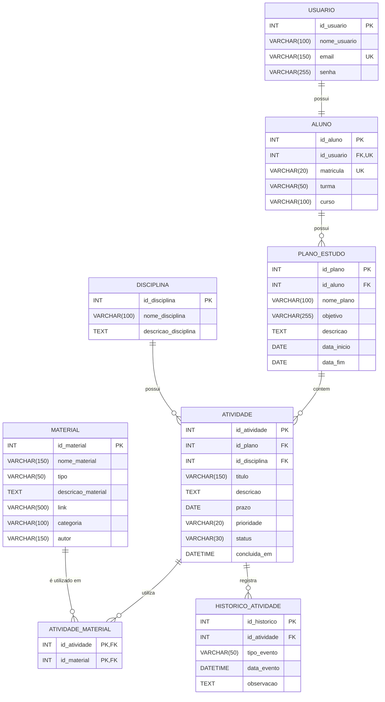

# StudyTrack — Plataforma de Estudos e Catálogo Inteligente

O **StudyTrack** é uma plataforma idealizada para ajudar estudantes a organizar e acompanhar sua rotina de estudos, conectando o planejamento acadêmico a um catálogo de livros e materiais de apoio disponíveis na biblioteca escolar.

> **Documentação completa da evolução do banco, consultas SQL e planejamento do sistema:** [relatorios.pdf](./relatorios.pdf).

## Sobre a ideia

A proposta surgiu da percepção de que muitos estudantes têm dificuldade para organizar tarefas, prazos e prioridades de estudo e, ao mesmo tempo, nem sempre conhecem os materiais que podem auxiliar sua aprendizagem. O StudyTrack busca reunir essas informações em um só lugar, facilitando o planejamento, o acompanhamento de prazos e a relação entre o conteúdo estudado e os recursos disponíveis.

O catálogo funciona como uma forma de consultar e organizar materiais — como livros e outros recursos de estudo — sem ter como foco o controle de empréstimos ou devoluções. A ideia é permitir que o aluno associe materiais relevantes a atividades que precisa realizar e acompanhe seu progresso ao longo do tempo.

O projeto está sendo desenvolvido de forma integrada entre as disciplinas de **Banco de Dados** e **Programação Orientada a Objetos (POO)**, no IFRN.

## Principais funcionalidades propostas (Escopo Final em POO)

- **Gestão de usuários e alunos:** cadastro, autenticação e vinculação das informações acadêmicas (matrícula, turma e curso).
- **Planos de estudo:** criação, edição, listagem e exclusão de planos com objetivos, descrição e período definido.
- **Atividades acadêmicas:** registro de tarefas, prazos, prioridades, status e data/hora efetiva de conclusão.
- **Histórico de alterações:** registro automático e consulta da linha do tempo de eventos das atividades (criação, mudanças de estado e conclusão).
- **Organização por disciplina:** associação das atividades às disciplinas correspondentes.
- **Catálogo de materiais:** cadastro, pesquisa e filtragem de livros e outros recursos de apoio por tipo, autor ou categoria.
- **Associação entre atividades e materiais:** vínculo e desvínculo dos recursos do catálogo às atividades para apoiar a organização dos estudos.
- **Relatórios gerenciais e de desempenho:** geração de consultas analíticas sobre conclusão de tarefas por curso/turma, acompanhamento de prazos críticos e materiais mais utilizados.

## Evolução do modelo

Partindo da versão inicial do projeto (composta por 7 tabelas e uma base preliminar de testes), o banco de dados foi revisado e evoluído para suportar rastreabilidade temporal, auditoria de ações e integridade referencial diretamente no SGBD.

- **SGBD utilizado:** MySQL 8.0.16 ou superior (necessário para suporte nativo às restrições `CHECK`).
- **Nome do banco de dados:** `studytrack_final`
- **Quantidade de tabelas:** 8 tabelas relacionais.
- **Total de registros de teste:** 4.000 registros.

### Principais melhorias implementadas

- **Registro temporal de conclusão:** inclusão da coluna `concluida_em` (`DATETIME`) na tabela `atividade` para registrar exatamente quando a tarefa foi finalizada e permitir comparações com o `prazo` estipulado.
- **Entidade de histórico (`historico_atividade`):** adição de uma oitava tabela ao modelo para preservar o histórico de eventos das atividades ao longo do tempo sem sobrescrever o estado atual.
- **Regras de negócio e integridade no banco:**
  - Restrições `UNIQUE` em `usuario(email)`, `aluno(id_usuario)` e `aluno(matricula)` para impedir duplicidade de contas e cadastros acadêmicos.
  - Restrições `CHECK` validando intervalos coerentes entre `data_inicio` e `data_fim`, valores permitidos para `prioridade` e `status`, e a regra que obriga o preenchimento de `concluida_em` apenas quando `status = 'concluida'`.
  - Exclusões configuradas com `ON DELETE RESTRICT` nas entidades principais (preservando o histórico acadêmico) e `ON DELETE CASCADE` nas dependências diretas da atividade (`atividade_material` e `historico_atividade`).

## Modelo de dados (DER)

O modelo lógico atualizado é organizado em oito tabelas que representam os usuários, os alunos, os planos de estudo, as disciplinas, as atividades, os materiais, a tabela associativa entre atividades e materiais e o histórico de eventos das atividades.



### Relações principais

- Um usuário está associado a exatamente um cadastro de aluno (`1:1`).
- Um aluno pode possuir vários planos de estudo (`1:N`).
- Cada plano de estudo reúne atividades (`1:N`).
- As atividades estão vinculadas a disciplinas (`1:N`).
- Uma atividade pode utilizar diferentes materiais, e um material pode estar associado a diferentes atividades (`N:N`), por meio da tabela `atividade_material`.
- Cada atividade registra múltiplos eventos cronológicos na tabela `historico_atividade` (`1:N`).

## Massa de dados e uso de Inteligência Artificial

Os dados da etapa anterior foram preservados e ampliados para **4.000 registros no total**, distribuídos de forma coerente com a frequência e necessidade das operações do sistema:

| Tabela | Descrição | Quantidade de Registros |
| :--- | :--- | :---: |
| `usuario` | Contas de acesso dos usuários | `100` |
| `aluno` | Perfis acadêmicos vinculados aos usuários | `100` |
| `disciplina` | Disciplinas cadastradas | `20` |
| `material` | Livros e recursos do catálogo | `230` |
| `plano_estudo` | Planos de estudo criados pelos alunos | `300` |
| `atividade` | Atividades acadêmicas com prazos e status | `600` |
| `atividade_material` | Associações N:N entre atividades e materiais | `850` |
| `historico_atividade` | Registros temporais de eventos das atividades | `1.800` |
| **Total** | **Soma de todos os registros da base** | **4.000** |

### Uso de IA na elaboração dos dados

Ferramentas de Inteligência Artificial foram utilizadas como apoio na geração da massa de dados fictícios, auxiliando na elaboração de nomes, títulos de atividades, descrições coerentes com o ambiente escolar, variação de categorias/status e distribuição de datas e horários para testes temporais. Todos os comandos `INSERT INTO` gerados passaram por revisão técnica da equipe para garantir integridade referencial, unicidade e conformidade com as restrições `CHECK` definidas no banco.

## Relatórios propostos

As consultas SQL completas, suas finalidades, tabelas envolvidas e resultados esperados estão documentados no arquivo [relatorios.pdf](./relatorios.pdf):

- **Desempenho de atividades por curso e turma:** analisa o total de tarefas criadas, concluídas, pendentes e canceladas, calculando o percentual de conclusão por curso e turma.
- **Acompanhamento de prazos e prioridades:** identifica atividades não concluídas com prazo vencido ou próximo, ordenadas por nível de prioridade e disciplina.
- **Materiais mais utilizados por tipo e categoria:** ranqueia os recursos do catálogo com maior número de vínculos em atividades acadêmicas.

## Tecnologias utilizadas

- **MySQL 8.0.16+:** sistema gerenciador de banco de dados relacional utilizado no projeto.
- **SQL:** linguagem utilizada para definir as tabelas, restrições de integridade, dados de teste e relatórios analíticos.
- **Mermaid:** sintaxe utilizada para representar o Diagrama Entidade-Relacionamento diretamente na documentação.
- **Git e GitHub:** versionamento do projeto e publicação na branch `projeto-dados-final`.

## Organização do projeto

```
StudyTrack/
├── app/                  # Lógica de negócio, entidades e serviços da aplicação (POO)
├── data/
│   └── database.sql      # Script SQL completo (estrutura das 8 tabelas + 4.000 registros)
├── docs/                 # Documentação complementar do projeto
├── exceptions/           # Exceções personalizadas do sistema
├── templates/            # Templates e modelos de exibição
├── tests/                # Testes da aplicação
├── ui/                   # Camada de interface com o usuário
├── config.py             # Configurações gerais do sistema
├── main.py               # Arquivo principal de execução da aplicação
├── relatorios.pdf        # Análise do modelo, DER, relatórios SQL e planejamento da versão em POO
└── README.md             # Documentação geral do projeto
```
## Instruções para executar o script SQL

O arquivo `database.sql` pode ser executado a partir de um servidor **MySQL 8.0.16** ou superior sem depender de nenhum outro arquivo.

### Pelo Terminal (MySQL CLI)

1. Conecte-se ao MySQL:
   ```bash
   mysql -u usuario -p
   ```
2. Execute o script:
   ```sql
   SOURCE data/database.sql;
   ```

### Pelo MySQL Workbench

1. Abra o MySQL Workbench e conecte-se à sua instância local.
2. Acesse **File > Open SQL Script...** e selecione o arquivo `database.sql`.
3. Clique no ícone de raio para criar o banco `studytrack_final`, as 8 tabelas e inserir os 4.000 registros.

### Conferência dos registros inseridos

Para verificar a contagem exata de registros em cada tabela após a execução:

```sql
USE studytrack_final;

SELECT 'usuario' AS tabela, COUNT(*) AS total FROM usuario
UNION ALL SELECT 'aluno', COUNT(*) FROM aluno
UNION ALL SELECT 'disciplina', COUNT(*) FROM disciplina
UNION ALL SELECT 'material', COUNT(*) FROM material
UNION ALL SELECT 'plano_estudo', COUNT(*) FROM plano_estudo
UNION ALL SELECT 'atividade', COUNT(*) FROM atividade
UNION ALL SELECT 'atividade_material', COUNT(*) FROM atividade_material
UNION ALL SELECT 'historico_atividade', COUNT(*) FROM historico_atividade;
```
## Equipe

Projeto desenvolvido por **Allef Braz, Fábio Heitor e Isaías Marques**, alunos do 2º ano do curso de Informática para Internet do IFRN Campus Natal Zona Norte.
**Disciplina:** Programação Orientada a Objetos (POO) e Banco de Dados  
**Instituição:** Instituto Federal de Educação, Ciência e Tecnologia do Rio Grande do Norte  
**Local:** Natal/RN  
**Ano:** 2026