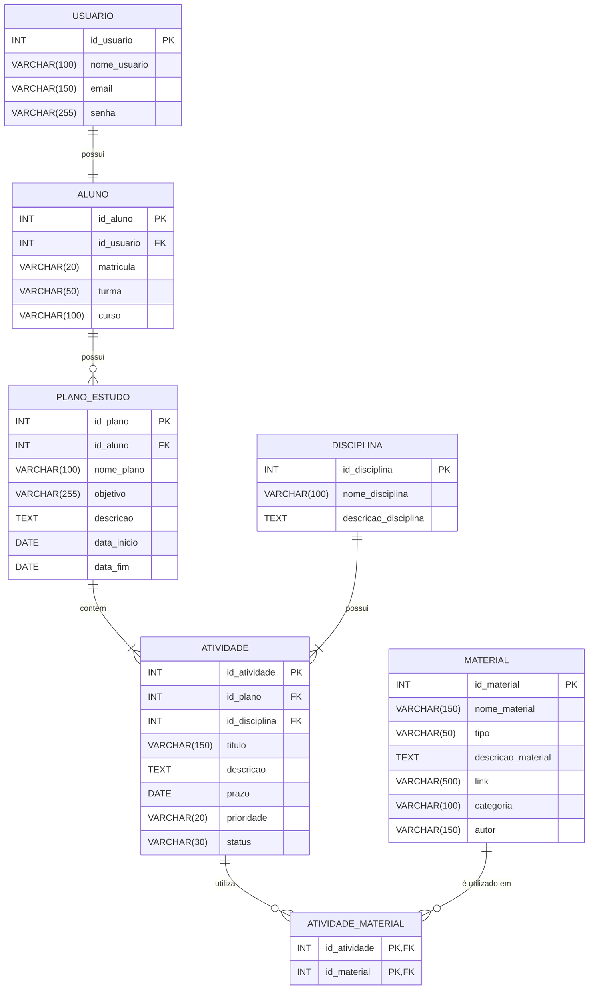

# StudyTrack — Plataforma de Estudos e Catálogo Inteligente

O **StudyTrack** é uma plataforma idealizada para ajudar estudantes a organizar e acompanhar sua rotina de estudos, conectando o planejamento acadêmico a um catálogo de livros e materiais de apoio disponíveis na biblioteca escolar.

## Sobre a ideia

A proposta surgiu da percepção de que muitos estudantes têm dificuldade para organizar tarefas, prazos e prioridades de estudo e, ao mesmo tempo, nem sempre conhecem os materiais que podem auxiliar sua aprendizagem. O StudyTrack busca reunir essas informações em um só lugar, facilitando o planejamento e a relação entre o conteúdo estudado e os recursos disponíveis.

O catálogo funciona como uma forma de consultar e organizar materiais — como livros e outros recursos de estudo —, sem ter como foco o controle de empréstimos ou devoluções. A ideia central é permitir que o aluno associe materiais relevantes às atividades que precisa realizar.

O projeto está sendo desenvolvido no contexto da disciplina de **Programação Orientada a Objetos (POO)**, no IFRN.

## Principais funcionalidades propostas

- **Planos de estudo:** criação de planos com objetivos, descrição e período definido.
- **Atividades acadêmicas:** registro de tarefas, prazos, prioridades e status.
- **Organização por disciplina:** associação das atividades às disciplinas correspondentes.
- **Catálogo de materiais:** cadastro e consulta de livros e outros recursos de apoio.
- **Associação entre atividades e materiais:** vínculo dos recursos do catálogo às atividades para apoiar a organização dos estudos.
- **Gestão de usuários:** identificação dos alunos e vinculação de suas informações acadêmicas.

Essas funcionalidades descrevem a proposta e o escopo do projeto; não significam que todos os recursos já estejam implementados em uma aplicação completa.

## Modelo de dados

O modelo lógico foi organizado em sete tabelas que representam os usuários, os alunos, os planos de estudo, as disciplinas, as atividades e os materiais, incluindo uma tabela de associação entre atividades e materiais.



### Relações principais

- Um usuário está associado a um cadastro de aluno.
- Um aluno pode possuir vários planos de estudo.
- Cada plano de estudo reúne atividades.
- As atividades estão vinculadas a disciplinas.
- Uma atividade pode utilizar diferentes materiais, e um material pode estar associado a diferentes atividades. A tabela `atividade_material` representa essa relação.

## Tecnologias

- **MySQL:** sistema gerenciador de banco de dados utilizado no modelo atual.
- **SQL:** linguagem utilizada para definir as tabelas, os relacionamentos e os dados de teste.

## Organização do projeto

```text
StudyTrack/
├── database.sql
└── README.md
```

A estrutura representa os arquivos de banco de dados e documentação atualmente considerados. Ela poderá ser ampliada conforme os demais módulos forem desenvolvidos.

## Equipe

Projeto desenvolvido por **Allef Braz, Fábio Heitor e Isaías Marques**, alunos do 2º ano do curso de Informática para Internet do IFRN Campus Natal Zona Norte.

**Disciplina:** Programação Orientada a Objetos (POO) e Banco de Dados 
**Instituição:** Instituto Federal de Educação, Ciência e Tecnologia do Rio Grande do Norte  
**Local:** Natal/RN  
**Ano:** 2026